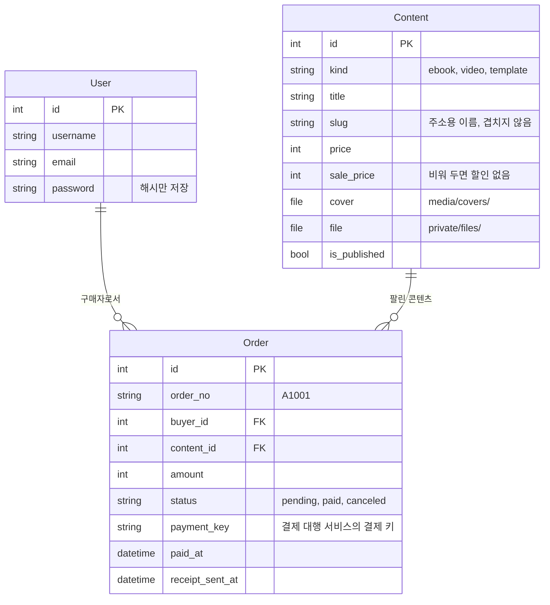
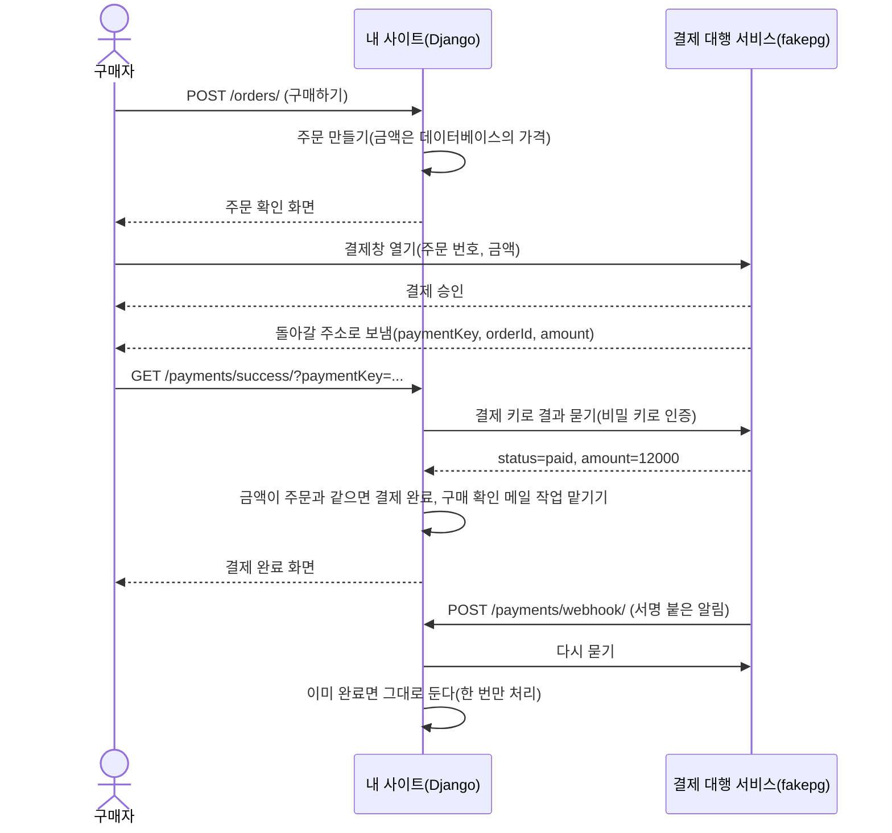

# 구조 안내

이 저장소의 폴더, 주소, 데이터, 흐름을 한 문서에 모았다. 코드를 읽기 전에 이 문서로 큰 그림을 잡는다.

## 1. 세 층으로 본 사이트

| 층 | 하는 일 | 이 저장소에서 |
|---|---|---|
| 프론트엔드(보이는 층) | 화면을 그려 브라우저에 보낸다 | `templates/`의 HTML, `static/css/site.css` |
| 백엔드(일하는 층) | 규칙을 적용하고 데이터를 읽고 쓰고 외부 서비스를 부른다 | `shop/`, `payments/`, `accounts/`의 `views.py`와 `services.py` |
| 데이터베이스(기억하는 층) | 회원, 콘텐츠, 주문을 오래 기억한다 | 개발 중 `db.sqlite3`, 운영은 PostgreSQL |

화면은 서버에서 그린다(서버 렌더링). 브라우저는 다 그려진 HTML을 받아 보여 주기만 한다. JavaScript 프레임워크는 쓰지 않는다.

## 2. 폴더

```text
my-shop/
├── config/          사이트 전체 설정(settings.py)과 주소 목록(urls.py)
├── accounts/        가입. 로그인, 로그아웃, 비밀번호 재설정은 Django 기본 기능
├── shop/            콘텐츠 표, 목록과 상세, 내 자료실, 내려받기, API, 관리 명령
├── payments/        주문 표, 결제 확인, 웹훅, 구매 확인 메일
├── fakepg/          가상 결제 서비스(바깥 서비스 역할, 실제 돈은 오가지 않는다)
├── templates/       화면 틀(HTML)과 메일 틀
├── static/          CSS, 아이콘, 설치형 웹 앱 매니페스트(누구나 받는다)
├── sample_data/     예시 콘텐츠의 표지와 판매 파일(seed_demo가 쓴다)
├── docs/            기획 메모, PRD, 와이어프레임, 요청 기록, 이 문서
├── media/           올린 표지 이미지(누구나 본다, 저장소에 올리지 않는다)
├── private/         판매 파일(공개 주소 없음, 저장소에 올리지 않는다)
├── AGENTS.md        AI 코딩 에이전트가 매번 읽는 규칙 파일
├── .env.example     환경 변수 예시(.env는 저장소에 올리지 않는다)
├── pyproject.toml   필요한 패키지 목록(의존성 파일)
└── uv.lock          패키지 판 번호를 고정한 잠금 파일
```

Django 앱 하나는 대개 이런 파일로 이루어진다.

| 파일 | 하는 일 |
|---|---|
| `models.py` | 데이터의 모양(표와 칸) |
| `views.py` | 요청을 받아 응답을 만드는 코드 |
| `urls.py` | 주소와 views의 함수를 잇는 목록 |
| `admin.py` | 관리자 화면에 무엇을 보일지 |
| `tests.py` | 자동 테스트 |
| `migrations/` | 표 구조를 바꾼 기록 |

## 3. 주소

| 주소 | 메서드 | 하는 일 | 누가 |
|---|---|---|---|
| `/contents/` | GET | 콘텐츠 목록(`?kind=ebook`으로 거르기) | 누구나 |
| `/contents/<slug>/` | GET | 콘텐츠 상세 | 누구나 |
| `/accounts/signup/` | GET, POST | 가입 | 누구나 |
| `/accounts/login/` | GET, POST | 로그인 | 누구나 |
| `/orders/` | POST | 주문 만들기(구매 버튼) | 로그인한 사람 |
| `/orders/<주문 번호>/` | GET | 주문 확인, 결제창으로 넘기기 | 그 주문의 구매자 |
| `/fake-pg/checkout/` | POST | 가상 결제창 | (바깥 서비스) |
| `/payments/success/` | GET | 결제창에서 돌아오는 주소, 서버가 결제를 다시 확인 | 그 주문의 구매자 |
| `/payments/webhook/` | POST | 결제 완료 알림 받기(서명 확인) | 결제 대행 서비스 |
| `/library/` | GET | 내 자료실 | 로그인한 사람 |
| `/download/<주문 id>/` | GET | 구매자 확인 뒤 서명 주소로 보내기 | 결제를 마친 구매자 |
| `/download/file/<서명>/` | GET | 판매 파일 내주기(5분 뒤 만료) | 결제를 마친 구매자 |
| `/library/<주문 id>/watch/` | GET | 강의 영상 보기 | 결제를 마친 구매자 |
| `/api/contents/` | GET | 콘텐츠 목록 JSON | 누구나 |
| `/admin/` | GET, POST | 관리자 화면 | 운영자 |

## 4. 데이터



- 주문은 회원과 콘텐츠를 외래 키로 가리킨다. 회원 한 명이 여러 번 사고, 콘텐츠 하나가 여러 번 팔린다.
- 회원이나 콘텐츠를 지우려 하면 막는다(`on_delete=PROTECT`). 구매 기록이 사라지지 않게 하려는 것이다.
- 금액은 원 단위 정수, 시각은 UTC로 저장하고 화면에는 한국 시간으로 보인다.

## 5. 결제 흐름



- 주소에 붙어 오는 `amount`와 `status`는 믿지 않는다. 결과는 서버가 결제 대행 서비스에 직접 물어 확인한다(`payments/services.py`).
- 결제창 복귀와 웹훅이 둘 다 와도 주문은 한 번만 결제 완료가 되고, 메일도 한 번만 나간다.
- 실제 결제 대행 서비스로 바꿀 때는 `payments/pg.py`의 `PaymentClient`를 그 서비스의 공식 문서에 맞춰 고친다. 테스트 키로 먼저 확인하고, 운영 키는 운영 서버의 환경 변수에만 넣는다.

## 6. 내려받기 흐름

```text
구매자가 [내려받기]를 누른다 -> GET /download/<주문 id>/
  1. 로그인했는가          아니면 로그인 화면으로
  2. 이 주문의 구매자인가    아니면 404(남의 주문은 없는 것처럼)
  3. 결제를 마쳤는가        아니면 403
통과하면 5분짜리 서명 주소(/download/file/<서명>/)로 보낸다
서명 주소에서 서명과 기한을 다시 확인하고 private/의 파일을 내준다
```

판매 파일은 `private/`에 있어 공개 주소가 없다. 표지(`media/`)와 달리 `/media/...`로 열리지 않는다.

## 7. 환경 변수

| 이름 | 뜻 | 개발 | 운영 |
|---|---|---|---|
| `DJANGO_SECRET_KEY` | 서명과 세션에 쓰는 비밀 키 | 아무 긴 값 | 새로 만든 긴 무작위 값 |
| `DJANGO_DEBUG` | 디버그 모드 | `true` | 넣지 않거나 `false` |
| `DJANGO_ALLOWED_HOSTS` | 받아 줄 도메인 | `127.0.0.1,localhost` | 내 도메인만 |
| `DJANGO_CSRF_TRUSTED_ORIGINS` | 양식을 믿을 출처 | 없음 | `https://내 도메인` |
| `DATABASE_URL` | 데이터베이스 주소 | 없음(SQLite) | PostgreSQL 주소 |
| `SITE_URL` | 결제 복귀·웹훅 주소를 만들 때 쓰는 사이트 주소 | `http://127.0.0.1:8000` | `https://내 도메인` |
| `PAYMENT_PUBLIC_KEY` | 결제창을 열 때 쓰는 공개 키 | `test_ck_...` | 결제 대행 서비스의 키 |
| `PAYMENT_SECRET_KEY` | 결제 결과를 물을 때 쓰는 비밀 키 | `test_sk_...` | 결제 대행 서비스의 키 |
| `PAYMENT_WEBHOOK_SECRET` | 웹훅 서명을 확인하는 비밀 값 | 아무 값 | 결제 대행 서비스가 준 값 |
| `EMAIL_*`, `DEFAULT_FROM_EMAIL` | 메일 발송 서비스 설정 | 없음(터미널에 찍힘) | 메일 발송 서비스의 값 |
| `OWNER_EMAIL` | 판매 보고를 받을 운영자 메일 | 예시값 | 운영자 메일 |
